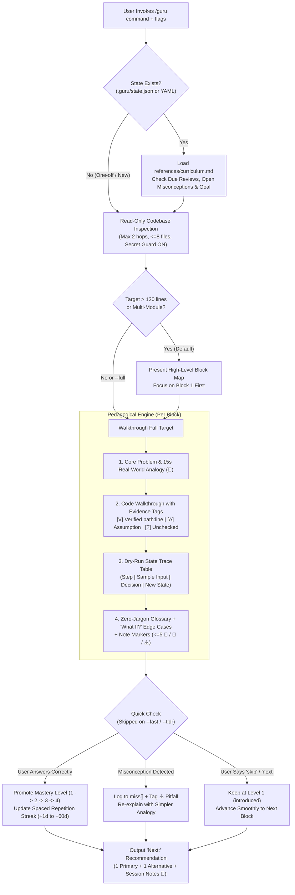
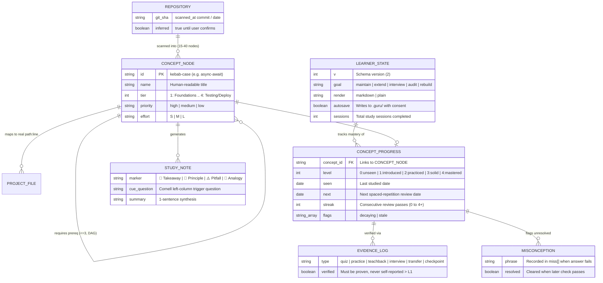

# 🧠 Guru (`guru-agent-skill`)

**Turn any AI coding agent into a Senior Staff Mentor, Adaptive Curriculum Manager, and Cornell Note-Taker — grounded directly in your real codebase.**

[](LICENSE)
[](#installation)
[](#)

---

## 🤔 What is Guru & Why Does It Exist?

AI coding assistants are great at shipping code fast—until you realize **you don't actually understand the codebase your AI just wrote**, or you're dropped into a massive legacy repository on day one and drown in hundreds of unfamiliar files.

Standard AI prompts fail at teaching because they:
1. **Translate syntax instead of teaching engineering reasoning** ("this line loops over items" instead of *why* the architecture exists and what breaks in production if it fails).
2. **Modify files uninvited** when you only asked a question.
3. **Dump walls of text** with floating jargon and zero pacing.
4. **Have complete amnesia** about what you already know, what misconceptions you still hold, and what you should learn next.

**Guru (`/guru`) solves this.** It is a portable, multi-file agent skill that transforms your AI coding agent into a **strictly read-only software engineering mentor** with:
- 🔍 **Evidence-Tagged Codebase Explanations** (`[V]` verified with `path:line`, `[A]` assumption, `[?]` unchecked) + **Dry-Run State Trace Tables**.
- 🗺️ **A Deterministic Curriculum Engine (`0–4` Mastery DAG)** that scans your repo, builds a 4-tier syllabus mapped to real project files, tracks misconceptions, and schedules **Spaced Repetition** reviews.
- 📝 **An Anti-Inflation Note-Taking Layer** that highlights key architectural invariants (`🔑`), production pitfalls (`⚠️`), mental models (`🧠`), and exports structured **Cornell Notes**.
- 🌐 **Automatic Language Mirroring** — 100% English core for high LLM instruction adherence, while automatically replying in whatever language you speak (English, Indonesian, Spanish, Japanese, etc.).

---

## 🔄 How Guru Teaches You (Architecture & Data Model)

### 1. End-to-End Teaching Lifecycle

When you invoke `/guru`, it follows a deterministic pedagogical loop rather than dumping unstructured text:



### 2. Curriculum, Mastery & Notes Entity-Relationship Diagram (ERD)

Under the hood, Guru structures your learning as a Relational/DAG model connecting real repository files to your mastery level and Cornell notes:



---

## ✨ Key Capabilities at a Glance

| Problem You Have | What You Run | What Guru Does |
| :--- | :--- | :--- |
| *"I just joined this repo and don't know where to start."* | `/guru onboard` or `/guru roadmap` | Maps entry points, 3 critical flows, and builds a 4-tier learning syllabus mapped to your real files. |
| *"How does checkout actually flow from button click to DB?"* | `/guru trace checkout` | Traces the end-to-end execution path with a flow diagram and a step-by-step **Dry-Run State Trace Table**. |
| *"This 400-line file is overwhelming."* | `/guru explain src/auth/session.ts` | Splits the file into a **Block Map**, explains Block 1 with analogies & edge cases, and paces step-by-step. |
| *"What breaks if I change this helper function?"* | `/guru impact verifyToken` | Analyzes the blast radius: callers, downstream dependents, test coverage, and risk level. |
| *"Why did we choose Redis Streams over Kafka here?"* | `/guru compare Redis Streams vs Kafka` | Builds an engineering trade-off matrix tied directly to your project's constraints. |
| *"Test if I really understand this module before my PR/interview."* | `/guru practice` or `/guru interview` | Runs code challenges from your repo with a progressive hint ladder (`H1 -> H2 -> H3`) or a 5-question Tech Lead mock interview. |
| *"What should I study next in 30 minutes?"* | `/guru plan 30m` or `/guru next` | Uses the Concept DAG, your active goal (`extend`, `maintain`, `interview`, `audit`, `rebuild`), and due spaced-repetition reviews to pick the highest-impact topic. |

---

## 🛡️ Built-In Engineering Discipline

1. **Read-Only by Default:** Guru never edits, creates, or commits project files during a mentoring session. Its only optional write is saving your learning state inside `.guru/`—and only after explicit consent.
2. **Evidence Tagging (`[V]` / `[A]` / `[?]`):** Every claim about your repository is tagged as `[V]` Verified (`path:line`), `[A]` Assumption/Inference, or `[?]` Not Yet Inspected. Zero hallucinated file descriptions.
3. **Discrete Mastery Scale (`0–4`):** No fragile floating-point math. Concepts progress deterministically through:
   - `0 = unseen` → `1 = introduced` → `2 = practiced` → `3 = solid` → `4 = mastered` (requires verified cross-file knowledge transfer and zero open misconceptions).
4. **Anti-Inflation Note Markers:** Strictly capped at <=5 markers (`📌` takeaway, `🔑` design principle, `⚠️` pitfall, `🧠` mental model) per block so your study notes stay high-signal. Pure Markdown (zero raw HTML tags like `<u>` that break CLI terminals).

---

## 📦 Repository Structure

```text
guru-agent-skill/
├── SKILL.md                  # Core mentor persona, guardrails, commands, flags & pacing
├── references/
│   ├── curriculum.md         # Concept DAG, 0-4 mastery rules, spaced repetition & gap radar
│   └── notes.md              # Note markers, anti-inflation rules & Cornell note templates
├── README.md                 # Documentation & cross-agent installation guide
└── LICENSE                   # MIT License
```

---

## 🚀 Installation Across AI Agents

Clone this repository first:

```bash
git clone https://github.com/contact-nathanealphi/guru-agent-skill.git
```

### 1. Antigravity / Claude Code / Codex CLI / Open Agent Skills (`~/.agent/skills` or `~/.claude/skills`)
Copy the folder into your global or workspace skills directory:

```bash
# Global skill (Antigravity / universal agent skills)
mkdir -p ~/.agent/skills/guru
cp -r guru-agent-skill/SKILL.md guru-agent-skill/references ~/.agent/skills/guru/

# Claude Code (project or global)
mkdir -p .claude/skills/guru
cp -r guru-agent-skill/SKILL.md guru-agent-skill/references .claude/skills/guru/
```

### 2. Cursor (`.cursor/rules`)
Copy the files into `.cursor/rules/guru/` or reference `SKILL.md` as an on-demand rule triggered by `/guru`:

```bash
mkdir -p .cursor/rules/guru
cp -r guru-agent-skill/SKILL.md guru-agent-skill/references .cursor/rules/guru/
```

### 3. Windsurf / GitHub Copilot / Gemini CLI
Place `guru-agent-skill` inside your workspace `.agent/skills/guru/` (or `.github/skills/guru/`) and invoke `/guru` in chat.

### 4. Web Chat (ChatGPT, Claude Web, Gemini Web)
Upload `SKILL.md`, `references/curriculum.md`, and `references/notes.md` to a Custom GPT, Claude Project, or Gemini Gem. Since Web Chat has no local filesystem access, Guru automatically uses a compact **YAML State Block** (`<=25 lines`) at the end of each session so you can copy-paste your learning progress across chats.

---

## 🎮 Command Reference

### Core Learning
| Command | Description |
| :--- | :--- |
| `/guru explain [target]` | Block-mapped walkthrough of a file, function, or module with analogies, `[V]` tags, and impact. |
| `/guru trace [workflow]` | End-to-end data flow diagram + **Dry-Run State Trace Table** with sample inputs. |
| `/guru glossary [term\|all]` | 4-column table: `Term` \| `Plain Meaning` \| `Real-World Analogy` \| `Where It Appears in This Project`. |
| `/guru roadmap` | Scans the repo to build a 4-tier progressive syllabus and seeds the concept graph. |
| `/guru compare [A vs B]` | Trade-off matrix explaining why the repo chose approach A and when migrating to B makes sense. |
| `/guru debug [error\|symptom]` | 4-step diagnostic reasoning: translation, root-cause hypotheses (`path:line`), verification, and fix. |
| `/guru practice [topic\|file]` | Micro-challenge grounded in real repo code (*Predict Output*, *Spot the Bug*, *Targeted Refactor*) with progressive hints. |
| `/guru interview [target]` | 5-question Tech Lead mock interview with candid feedback, model answers, and a 1–5 scorecard. |
| `/guru ask [question]` | Crisp direct answer (`<=8 lines`), misconception check, tied back to your project. |

### Codebase Analysis & Active Learning
| Command | Description |
| :--- | :--- |
| `/guru onboard` | 10-minute tour of an unfamiliar repository: architecture map, entry points, 3 key flows, and reading order. |
| `/guru impact [fn\|file]` | Blast-radius analysis: callers, dependents, tests, and risk level if modified. |
| `/guru history [file\|commit]` | Uses `git log/blame/diff` to explain why the code evolved this way. |
| `/guru review [file\|diff]` | Educational review: code smells, security threat flows (`input -> boundary -> sink`), Big-O bottlenecks. |
| `/guru deps` / `/guru tests` | Explains key dependencies & lock-in risks, or maps test blind spots with a guided test-writing drill. |
| `/guru teachback [concept]` | Feynman technique: explain a concept in your own words; Guru audits accuracy and updates mastery. |
| `/guru rebuild [feature]` | Guided step-by-step reconstruction of a simplified feature using small `TODO` scaffolds. |

### Curriculum & Notes Management
| Command | Description |
| :--- | :--- |
| `/guru curriculum` / `status` | Visualizes the 4-tier concept graph with mastery icons (`○ ◔ ◑ ◕ ● ↻`) or a compact progress dashboard. |
| `/guru next` / `gaps` / `plan 30m` | Recommends the highest-impact next topic, lists blocking knowledge gaps, or builds a time-boxed study plan. |
| `/guru goal [maintain\|extend\|interview\|audit\|rebuild]` | Re-prioritizes the curriculum engine around your current engineering objective. |
| `/guru revisit` / `checkpoint [tier]` | Runs a 3–5 min spaced-repetition flashcard drill or a 5-question tier checkpoint. |
| `/guru notes [concept\|session\|export]` | Compiles structured Cornell Notes (`Cue Question` \| `Notes` + `1-Sentence Summary`). |
| `/guru mark [text]` / `known [item]` | Saves a custom takeaway or marks a concept as already known so Guru stops highlighting it. |
| `/guru recap` | Ends the session with a summary, progress diff, next step, and `📝 Session Notes`. |

### Power Flags
Combine any command with flags to control depth and pacing:
- `--beginner` / `--standard` (default) / `--deep` — Adjust technical depth.
- `--fast` or `--fix` — Direct answer/patch first, 3-line explanation after, skip Quick Check.
- `--socratic` — Guide strictly via questions and hints before revealing answers.
- `--tldr` — Maximum 5 lines of `📌` takeaways.
- `--full` — Skip chunking and walk through the entire file at once.
- `--notes off|min|full` — Control note-marker density.

---

## 📄 License

Released under the [MIT License](LICENSE). Free to use, fork, and adapt across personal and commercial workflows.
